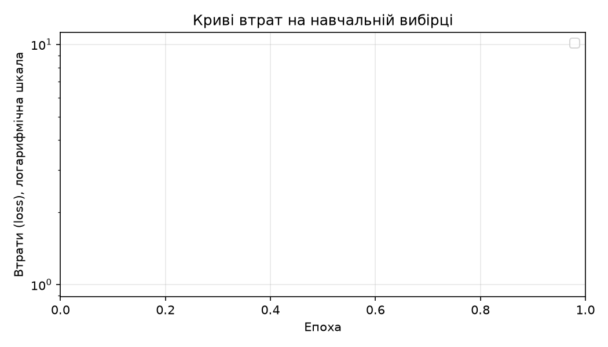
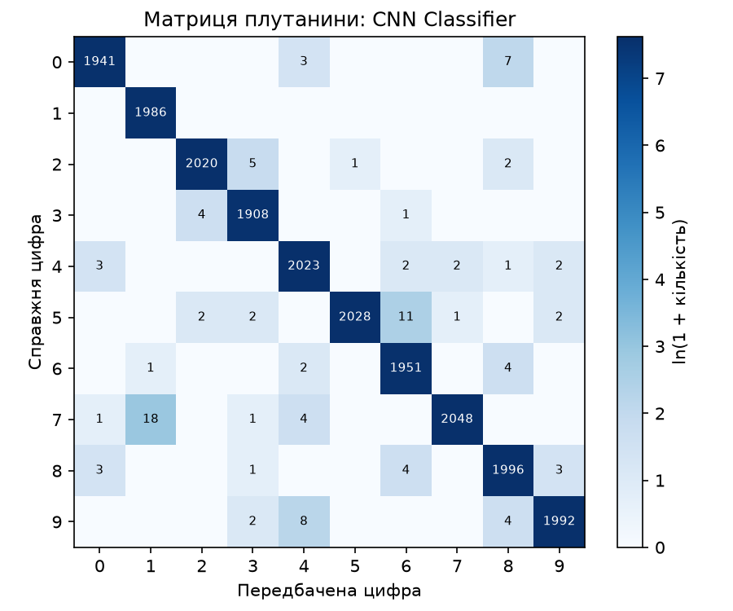
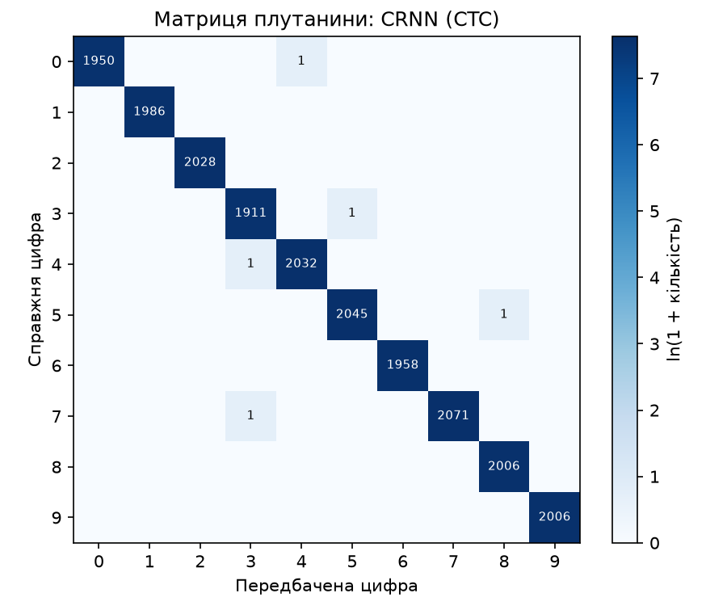

# Лабораторна робота №5

**Дисципліна:** «Штучний інтелект в задачах комп'ютерної інженерії»
**Тема:** Згорткові нейронні мережі (CNN) та комп'ютерний зір в задачах автоматизації на мові Python (PyTorch/OpenCV)
**Варіант 4 (CS):** оптичне розпізнавання лічильників та приладів (OCR)

## 1. Мета роботи

Здобути практичні навички конструювання та навчання згорткових нейронних мереж: проєктування архітектур згортки та пулінгу, побудова послідовнісної моделі CRNN із функцією втрат CTC, порівняння двох підходів за точністю, швидкістю та розміром моделі.

**Інженерна мета варіанта:** автоматизувати збір показань цифрових приладів, тобто за зображенням семисегментного індикатора отримати числове значення, наприклад `04718`.

## 2. Дані

Реальних розмічених фотографій лічильників немає, тому датасет згенеровано синтетично за допомогою OpenCV:

- кожна цифра малюється як комбінація зі 7 сегментів на полотні 32×32 (таблиця «цифра → увімкнені сегменти»);
- число складається з 5 випадкових цифр, які з'єднуються по горизонталі, тож зображення має розмір 32×160, а мітка є рядком (`"04718"`, ведучі нулі зберігаються);
- аугментації: зсув (окремо для кожної цифри та для всього рядка, до ±3 пікселів), випадкова яскравість (множник 0.5–1.0), випадковий сірий фон (+0…40), розмиття Гаусса (у 50 % зображень);
- усього 20 000 зображень: 16 000 для навчання та 4 000 для валідації. Поділ фіксований (`seed = 0`), тому обидві моделі навчаються та оцінюються на тих самих даних.

## 3. Архітектури

### 3.1. CNN Classifier (`MultiDigitCNN`)

| Шар | Вихід |
|---|---|
| Вхід | 1×32×160 |
| Conv(1→8, 3×3, pad 1) + ReLU + MaxPool(2) | 8×16×80 |
| Conv(8→16, 3×3, pad 1) + ReLU + MaxPool(2) | 16×8×40 |
| Flatten | 5120 |
| Linear(5120 → 50), перетворення на 5×10 | 5 позицій × 10 оцінок |

Параметрів: **257 298**. Втрати: CrossEntropy, кожна з 5 позицій вважається окремим передбаченням. Модель жорстко прив'язана до рівно 5 цифр.

### 3.2. CRNN (`CRNN`)

| Шар | Вихід |
|---|---|
| Вхід | 1×32×160 |
| Conv(1→16) + ReLU + MaxPool(2) | 16×16×80 |
| Conv(16→32) + ReLU + MaxPool(2) | 32×8×40 |
| Перетворення на послідовність | 40 кроків × 256 ознак |
| BiLSTM(256 → 64 у кожному напрямку) | 40 × 128 |
| Linear(128 → 11) | 40 × 11 (10 цифр + blank) |

Параметрів: **171 083**. Втрати: `CTCLoss(blank=10)`. Ті самі ваги застосовуються на кожній позиції зображення, а кількість цифр не зашита в архітектуру.

## 4. Методика експерименту

- Оптимізатор Adam, `lr = 1e-3`, розмір батча 64, 10 епох для кожної моделі.
- **Accuracy (цифри):** частка правильно розпізнаних цифр.
- **Accuracy (числа, exact match):** частка зображень, у яких усі цифри розпізнано правильно.
- **F1:** по кожному з 10 класів цифр, далі усереднення (macro). Для CRNN порівняння виконується позиція в позицію між декодованим рядком і міткою.
- **CER (Character Error Rate):** відстань Левенштейна між розпізнаним і справжнім рядком, поділена на довжину мітки, усереднена за валідацією.
- **Час навчання:** середній час однієї епохи (лише прохід по навчальній вибірці, без валідації).
- **Час інференсу:** час проходу по валідаційній вибірці, поділений на кількість зображень (включає читання PNG з диска).
- **Пам'ять:** розмір параметрів моделі в КБ (кількість параметрів × 4 байти для float32). Модуль `tracemalloc` не використовувався, оскільки він враховує лише пам'ять Python і не бачить тензорів PyTorch.

## 5. Результати

### 5.1. Порівняльна таблиця

| Архітектура | Accuracy цифр (%) | Accuracy чисел (%) | F1 (macro) | CER | Час навчання (мс/епоха) | Інференс (мс/зобр.) | Розмір моделі (КБ) |
|---|---|---|---|---|---|---|---|
| CNN Classifier | 99.80 | 99.03 | ≈ 0.998 | ≈ 0.002 | 8782.6 | 0.285 | 1005.1 |
| CRNN (CTC) | 100.00 | 100.00 | 1.000 | 0.000 | 18455.7 | 0.598 | 668.3 |

> Значення F1 та CER для CNN Classifier потрібно замінити на точні з виводу `main.py` (рядки «F1-Score» та «CER»). Для CRNN усі 4000 валідаційних чисел розпізнано правильно, тож F1 = 1.000 та CER = 0.

### 5.2. Криві втрат

*Рис. 1. Середні втрати на навчальній вибірці по епохах (логарифмічна шкала).*

| Епоха | 1 | 2 | 3 | 4 | 5 | 6 | 7 | 8 | 9 | 10 |
|---|---|---|---|---|---|---|---|---|---|---|
| CNN Classifier | 0.8743 | 0.0798 | 0.0326 | 0.0153 | 0.0124 | 0.0137 | 0.0131 | 0.0083 | 0.0036 | 0.0016 |
| CRNN (CTC) | 3.0042 | 1.4938 | 0.1139 | 0.0257 | 0.0126 | 0.0077 | 0.0053 | 0.0038 | 0.0029 | 0.0022 |

У CRNN у першій епосі точність на валідації дорівнює 0: мережа спочатку видає лише символи blank, і лише з другої-третьої епохи починає розпізнавати цифри. Це типова поведінка CTC. Крива CNN спадає швидше на перших епохах, але на епохах 4–7 коливається (0.0153 → 0.0124 → 0.0137 → 0.0131), тоді як CRNN спадає монотонно.

### 5.3. Матриці плутанини

*Рис. 2. Матриця плутанини по цифрах 0–9, CNN Classifier (валідація, 4000 чисел = 20 000 цифр).*

*Рис. 3. Матриця плутанини по цифрах 0–9, CRNN (CTC).*

У CRNN усі значення лежать на діагоналі. У CNN Classifier помилки поодинокі: близько 40 неправильних цифр із 20 000 (Accuracy 99.80 %), що відповідає 39 неправильно прочитаним числам із 4000.

## 6. Аналіз та висновки

1. **Точність.** Обидві моделі добре розпізнають синтетичні показання: CNN Classifier досягає 99.03 % повністю правильних чисел, CRNN — 100 %. Різниця становить менше одного відсоткового пункту (39 помилок на 4000 чисел) і отримана в одному запуску, тому її слід трактувати обережно: на такій простій вибірці обидві моделі близькі до стелі.
2. **Розмір.** CRNN менша: 171 083 параметри (668 КБ) проти 257 298 (1005 КБ). Причина в тому, що CNN Classifier має окремий повнозв'язний шар `Linear(5120 → 50)`, який містить майже всі її параметри (256 050 із 257 298), а CRNN повторно використовує ті самі ваги на кожній позиції зображення.
3. **Швидкість.** CRNN приблизно вдвічі повільніша і в навчанні (18.5 с проти 8.8 с на епоху), і в інференсі (0.60 мс проти 0.28 мс на зображення) через рекурентний шар LSTM. Для автоматизації зчитування лічильників обидва значення цілком достатні: навіть 0.6 мс на зображення дає понад 1500 зображень на секунду на CPU.
4. **Гнучкість.** CNN Classifier розпізнає лише числа з рівно 5 цифр, а CRNN із CTC не залежить від кількості цифр і не потребує розмітки позицій. Це головна практична перевага CRNN для реальних приладів, де розрядність може відрізнятися.
5. **Розмір навчальної вибірки.** При навчанні CNN Classifier на 4000 зображень повна точність чисел становила 0.919 при майже нульових втратах на навчанні, тобто спостерігалося перенавчання. Збільшення вибірки до 16 000 зображень підняло точність до 0.98–0.99. Генерація синтетичних даних безкоштовна, тому збільшення вибірки є найдешевшим способом покращити модель.

**Рекомендація:** для автоматичного зчитування показань краще підходить CRNN: вона точніша, менша та працює зі змінною кількістю цифр, а її вищий час навчання та інференсу не є критичним.

## 7. Обмеження

- Дані синтетичні: на реальних фотографіях (відблиски, нахил, різні шрифти) результати будуть нижчими, і різниця між моделями може змінитися.
- Кожен результат отримано з одного запуску з фіксованим `seed = 0`; для оцінки розкиду потрібні кілька запусків.
- Усі числа мають однакову довжину (5 цифр), тому перевага CRNN у роботі зі змінною довжиною в цьому експерименті не перевірялася.
- Transfer Learning (ResNet18) для варіанта 4 не застосовувався: завдання варіанта передбачає порівняння CNN Classifier та CRNN.